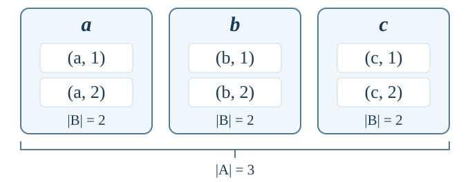
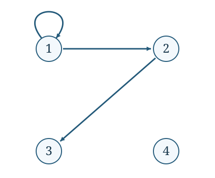
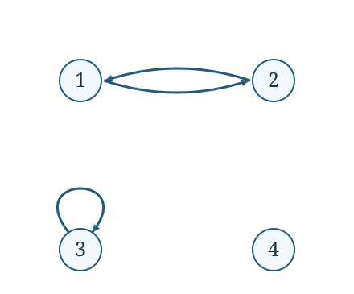

# יחסים {chapter="3"}

בפרק הקודם הוספנו לאוצר המילים המתמטי את המושג **קבוצה**. בפרק זה נרחיב את השפה בעזרת המושג **יחס**, שיאפשר לנו לתאר קשרים בין איברים של קבוצות.

## זוגות סדורים ומכפלה קרטזית {#sec-cartesian-product}

### כאן הסדר דווקא חשוב {#sec-ordered-pair}

כדי לציין מקום באולם, צריך לדעת גם את מספר השורה וגם את מספר הכיסא. הקבוצה $\{2,5\}$ אינה מבדילה בין ״שורה 2, כיסא 5״ לבין ״שורה 5, כיסא 2״, כי $\{2,5\}=\{5,2\}$. לכן נשתמש בכתיב שבו המקום הראשון מציין את השורה והמקום השני מציין את הכיסא: $(2,5)$ ו־$(5,2)$ יציינו מקומות שונים באולם. כתיב כזה נקרא **זוג סדור**.

::: {.thmdef title="זוג סדור"}
[**זוג סדור**]{.term} הוא זוג של **איברים שאינם בהכרח שונים**, הכתובים בסדר מסוים, כאשר **יש חשיבות לסדרם**. האיבר במקום הראשון נקרא **הרכיב הראשון**, והאיבר במקום השני נקרא **הרכיב השני**. הזוג הסדור שהרכיב הראשון שלו הוא $a$ והרכיב השני שלו הוא $b$ מסומן ב־$(a,b)$.

שני זוגות סדורים שווים אם ורק אם **הרכיבים במקומות המתאימים שווים**:

$$(a,b)=(c,d)\quad\Longleftrightarrow\quad a=c\ \land\ b=d.$$

:::

**הערה.** ייתכן ש־$a=b$. למשל, בזוג $(2,2)$ המספר $2$ מופיע בשני המקומות, ואילו הקבוצה $\{2,2\}=\{2\}$ מכילה איבר אחד בלבד.

::: {.thmexm title="מחליפים מקומות, ומשווים רכיבים"}

- $(2,5)\ne(5,2)$: הרכיבים הראשונים שונים. לעומת זאת, $\{2,5\}=\{5,2\}$, כי בקבוצה הסדר אינו חשוב.
- $(2,5)\ne(2,7)$: שוויון הרכיב הראשון לבדו אינו מספיק; גם הרכיבים השניים צריכים להיות שווים.
:::

:::: {.thmchk}
בחרו תנאי על $a,b$ השקול לשוויון $(a,b)=(b,a)$. נמקו לפי הגדרת השוויון של זוגות.

::: {.sets-exercise data-sets="ordered-pair-swap"}
בחרו תשובה ובדקו את הנימוק.
:::
::::

::::: {.thmqst title="מוצאים את הרכיבים"}
::: {.sets-exercise data-sets="ordered-pair-components"}
מצאו את $x$ ואת $y$ אם $(x+1,4)=(3,y-2)$. כתבו את שני הערכים ובדקו את התשובה.
:::

:::::

### כל הצירופים של שתי בחירות {#sec-product-definition}

אם יש שתי אפשרויות לשורה ושלוש אפשרויות לכיסא בכל שורה, אפשר ליצור שישה זוגות של ״שורה, כיסא״. כל מקום מתקבל מבחירה ראשונה ואחריה בחירה שנייה.

::: {.thmdef title="מכפלה קרטזית"}
ה[**מכפלה הקרטזית**]{.term} $A\times B$ היא קבוצת כל הזוגות הסדורים $(a,b)$ שבהם $a\in A$ ו־$b\in B$.

$$A\times B=\{(a,b)\mid a\in A\quad\heb{וגם}\quad b\in B\}.$$

הסימן $\times$ מציין כאן פעולה על קבוצות: בחירת רכיב ראשון מ־$A$ ורכיב שני מ־$B$. לא כופלים את ערכי הרכיבים.
:::

::: {.thmexm title="ארבעה זוגות, ולא ארבע מכפלות"}
עבור $A=\{1,2\}$ ו־$B=\{2,4\}$ מתקבל

$$A\times B=\{(1,2),(1,4),(2,2),(2,4)\}.$$

הזוג $(1,4)$ שייך למכפלה כי $1\in A$ ו־$4\in B$. לעומת זאת, $(4,1)$ אינו שייך לה: הרכיב הראשון אינו ב־$A$ וגם הרכיב השני אינו ב־$B$. המספר $4$ אינו איבר של $A\times B$; איברי המכפלה הם זוגות סדורים.
:::

:::: {.thmexm title="כל אחד משני התנאים נחוץ"}
תהיינה $A=\{1,2\}$ ו־$B=\{2,4\}$. בדקו בכל זוג אם שני הרכיבים מקיימים את תנאי השייכות למכפלה.

::: {.sets-exercise data-sets="product-coordinate-check"}
האם $(1,7)$ שייך ל־$A\times B$? האם $(7,2)$ שייך ל־$A\times B$? ענו ונמקו.
:::
::::

### הסדר, המספר והקבוצה הריקה {#sec-product-properties}

::: {.thmexm title="מכפלות בסדר הפוך"}
תהיינה $A=\{1\}$ ו־$B=\{2,3\}$. אז

$$A\times B=\{(1,2),(1,3)\},$$

$$B\times A=\{(2,1),(3,1)\}.$$

אלו קבוצות שונות, אף שיש בהן אותו מספר איברים. למשל, $(1,2)$ שייך ל־$A\times B$ ואינו שייך ל־$B\times A$.
:::

::: {.thmwarn title="סדר הקבוצות במכפלה קרטזית"}
החלפת סדר הקבוצות מחליפה את התפקידים של שני הרכיבים. לכן אין להניח ש־$A\times B=B\times A$.
:::

::: {.thmthm title="עצמת מכפלה קרטזית"}
תהיינה $A,B$ קבוצות סופיות. אז

$$|A\times B|=|A|\cdot|B|.$$
:::

::: {.thmproof}
לכל $a\in A$, הזוגות שהרכיב הראשון שלהם הוא $a$ הם בדיוק הזוגות $(a,b)$ שבהם $b\in B$. לכל איבר של $B$ מתקבל זוג אחד, ולכן יש בדיוק $|B|$ זוגות שהרכיב הראשון שלהם הוא $a$.

בקבוצה $A$ יש $|A|$ איברים. לכן יש $|A|$ קבוצות של זוגות, אחת לכל בחירה של הרכיב הראשון, ובכל אחת מהן בדיוק $|B|$ זוגות. כל זוג ב־$A\times B$ נספר בדיוק פעם אחת, בקבוצה המתאימה לרכיב הראשון שלו.

מספר הזוגות הכולל הוא סכום של $|A|$ מחוברים, שכל אחד מהם שווה ל־$|B|$. סכום זה הוא $|A|\cdot|B|$, לפי הגדרת הכפל במספרים טבעיים כחיבור חוזר. לכן

$$|A\times B|=|A|\cdot|B|.$$

אם אחת הקבוצות ריקה, אין זוגות במכפלה, ושני אגפי השוויון שווים לאפס.
:::

::: {.thmexm title="ספירת הזוגות במכפלה"}
תהיינה $A=\{a,b,c\}$ ו־$B=\{1,2\}$. נחלק את הזוגות לתיבות לפי הרכיב הראשון:

{width=680 fig-alt="שלוש תיבות, אחת לכל איבר של A. בתיבה a הזוגות (a,1) ו־(a,2), בתיבה b הזוגות (b,1) ו־(b,2), ובתיבה c הזוגות (c,1) ו־(c,2). בכל תיבה שני זוגות, ובסך הכול שישה."}

כמה זוגות יש בתיבות בסך הכול? יש $|A|=3$ תיבות, ובכל אחת בדיוק $|B|=2$ זוגות. לכן

$$|A\times B|=2+2+2=3\cdot2=6.$$

אם מחליפים את $B$ בקבוצה הריקה, אין זוגות באף תיבה, ומספר הזוגות הוא $3\cdot0=0$.
:::

::: {.thmkey title="מכפלה עם הקבוצה הריקה"}
אם אחת הקבוצות ריקה, אי אפשר לבחור ממנה רכיב לזוג. לכן, לכל קבוצה $A$,

$$A\times\varnothing=\varnothing\times A=\varnothing.$$
:::

::: {.thmexm title="הקבוצה הריקה לעומת קבוצה שמכילה אותה"}
תהי $A=\{1,2\}$. המכפלה $A\times\varnothing$ ריקה. לעומת זאת,

$$A\times\{\varnothing\}=\{(1,\varnothing),(2,\varnothing)\}.$$

הקבוצה $\{\varnothing\}$ מכילה איבר אחד, ואפשר להשתמש בו כרכיב שני. לכן במכפלה $A\times\{\varnothing\}$ יש שני זוגות.
:::

::: {.thmsummary title="שתי בחירות עם תפקידים"}

- בזוג סדור המקום חשוב; בקבוצה סדר האיברים אינו חשוב.
- $(a,b)\in A\times B$ כאשר $a\in A$ וגם $b\in B$.
- בקבוצות סופיות מכפילים את מספר האפשרויות בשני המקומות.
:::

### תרגול לסעיף: מכפלה קרטזית {#practice-sets-product}

:::: {.thmchk}
נתון $A=\{1\}$ ו־$B=\{2\}$. ענו על שתי השאלות ונמקו.

::: {.sets-exercise data-sets="product-equality-check"}
בחרו תשובה ובדקו את הנימוק.
:::
::::

::::: {.thmqst}
באולם יש שתי שורות, $1,2$, ובכל שורה שלושה כיסאות, $1,2,3$. כתבו את קבוצת המקומות, כאשר הרכיב הראשון הוא מספר השורה.

::: {.sets-exercise data-sets="product-seating-roster"}
כתבו את התשובה כקבוצה של זוגות סדורים, בתבנית `{(a,b),(c,d)}`.
:::

::: {.foldable title="פתרון והסבר"}
קבוצת המקומות היא $\{1,2\}\times\{1,2,3\}$, כלומר

$$\{(1,1),(1,2),(1,3),(2,1),(2,2),(2,3)\}.$$

יש $2\cdot3=6$ מקומות. הזוג $(3,1)$ אינו ברשימה, כי אין שורה $3$.
:::
:::::

::: {.thmqst}
תהיינה $A=\{1,2\}$ ו־$B=\{2,4\}$. כתבו את $A\times B$.

:::: {.sets-exercise data-sets="product-full-roster"}
הקלידו את כל הזוגות הסדורים בתוך קבוצה, למשל `{(a,b),(c,d)}`. אפשר לבדוק את התשובה או לבחור להציג אותה.
::::
:::

:::: {.thmgame title="מכפלה קרטזית של מספרים וסוגי קלפים"}
נבחר את קבוצת המספרים $A=\{2,3\}$ ואת קבוצת הסוגים $B=\{\heb{לב},\heb{עלה}\}$. קלף מיוצג בזוג סדור: המספר הוא הרכיב הראשון והסוג הוא הרכיב השני. למשל, $(2,\heb{לב})$ מייצג קלף שמספרו $2$ וסוגו לב.

::: {.sets-exercise data-sets="pairs"}
בחרו את כל הקלפים ששייכים ל־$A\times B$.
:::
::::

:::: {.thmqst}
::: {.sets-exercise data-sets="pair-check"}
השוו זוגות וקבוצות, ספרו זוגות ובדקו מכפלה עם הקבוצה הריקה.
:::
::::

:::: {.thmqst #practice-set-q-product}
::: {.sets-exercise data-sets="practice-product"}
כתבו את שתי המכפלות הקרטזיות לפי הסדר המבוקש.
:::
::::

<!-- Starting point: Velleman, How to Prove It, 2nd ed., section 4.2, definition 4.2.1. Examples and teaching sequence adapted for this course. -->

## יחסים בין קבוצות {#sec-relations-between-sets}

### מן האפשרויות אל הקשרים שמתקיימים {#sec-relation-definition}

נניח שבודקים הרשמה לשני חוגים. נסמן את קבוצת הסטודנטים ב־$A=\{\heb{דנה},\heb{נועם},\heb{רוני}\}$ ואת קבוצת החוגים ב־$B=\{\heb{שחמט},\heb{צילום}\}$. המכפלה $A\times B$ מכילה את כל ששת הזוגות האפשריים של סטודנט וחוג. כדי לתאר מי נרשם לאיזה חוג, נשמור רק את הזוגות שבהם הסטודנט אכן נרשם לחוג. כך נקבל תת־קבוצה של $A\times B$.

::: {#box-relation-between-sets .thmdef title="יחס בין קבוצות"}
תהיינה $A,B$ קבוצות. [**יחס מ־$A$ ל־$B$**]{.term} הוא קבוצה $R$ של זוגות סדורים המקיימת

$$R\subseteq A\times B.$$

כלומר, לכל $(a,b)\in R$ מתקיים $a\in A$ וגם $b\in B$. כותבים גם $aRb$ במקום $(a,b)\in R$, וקוראים: ״$a$ עומד ביחס $R$ ל־$b$״.
:::

::: {.thmexm title="מי נרשם לאיזה חוג?"}
נניח שדנה נרשמה לשחמט ולצילום, נועם נרשם לצילום בלבד, ורוני לא נרשם לאף אחד משני החוגים. יחס ההרשמה הוא

$$R=\{(\heb{דנה},\heb{שחמט}),(\heb{דנה},\heb{צילום}),(\heb{נועם},\heb{צילום})\}.$$

למשל, $(\heb{דנה},\heb{שחמט})\in R$, ואפשר לכתוב גם $\heb{דנה}\,R\,\heb{שחמט}$. לעומת זאת, $(\heb{נועם},\heb{שחמט})\notin R$, אף שהזוג שייך ל־$A\times B$.

דנה מופיעה כרכיב ראשון בשני זוגות ורוני אינו מופיע בשום זוג. שני המצבים מותרים: הגדרת יחס אינה דורשת שכל איבר של $A$ יופיע, ואינה מגבילה את מספר הזוגות שבהם הוא מופיע.
:::

::: {.thmexm title="יחס המתואר באמצעות תנאי"}
תהיינה $A=\{1,2,3\}$ ו־$B=\{2,4\}$. נגדיר

$$R=\{(a,b)\in A\times B\mid a<b\}.$$

עבור $a=1$ שני איברי $B$ גדולים ממנו; עבור $a=2$ ועבור $a=3$ רק $4$ גדול מ־$a$. לכן

$$R=\{(1,2),(1,4),(2,4),(3,4)\}.$$

למשל, $2R4$ הוא פסוק אמת, ואילו $2R2$ הוא פסוק שקר. גם $(1,3)$ אינו שייך ל־$R$: האי־שוויון $1<3$ מתקיים, אך $3\notin B$. התנאי $a<b$ בוחר זוגות מתוך $A\times B$ בלבד.
:::

::: {.thmexm title="בלי קשרים, או עם כל הקשרים"}
עבור $A=\{1,2\}$ ו־$B=\{3\}$, גם $\varnothing$ וגם $A\times B=\{(1,3),(2,3)\}$ הם יחסים מ־$A$ ל־$B$. הראשון אינו מכיל אף זוג, והשני מכיל את כל הזוגות האפשריים. ההגדרה דורשת הכלה, ולכן אינה מוציאה אף אחד משני המקרים האלה.

אם $B=\varnothing$, המכפלה $A\times B$ ריקה. במקרה זה היחס היחיד מ־$A$ ל־$B$ הוא $\varnothing$, כי לקבוצה הריקה יש רק תת־קבוצה אחת.
:::

::: {.thmexm title="זוג אחד מחוץ למכפלה מספיק"}
עבור $A=\{1,2\}$ ו־$B=\{3\}$, הקבוצה $S=\{(1,3),(2,5)\}$ אינה יחס מ־$A$ ל־$B$, כי $5\notin B$ ולכן $(2,5)\notin A\times B$. אם מחליפים את $B$ בקבוצה $C=\{3,5\}$, אז $S$ היא יחס מ־$A$ ל־$C$. לכן בבדיקה אם קבוצה של זוגות היא יחס בין קבוצות נתונות, צריך לבדוק גם את הקבוצות שצוינו.
:::

### בדיקה עצמית: מה ההגדרה דורשת? {#sec-relations-self-check}

:::: {.thmchk}
תהיינה $A=\{1,2\}$ ו־$B=\{3,4\}$. קבעו בכל סעיף אם הקבוצה הנתונה היא יחס מ־$A$ ל־$B$.

::: {.sets-exercise data-sets="relations-classify"}
בחרו תשובה ובדקו את הנימוק.
:::
::::

:::: {.thmchk}
נתון $R\subseteq A\times B$, וכן $a\in A$ ו־$b\in B$.

::: {.sets-exercise data-sets="relation-membership-check"}
האם בהכרח $aRb$?
:::

אם לא, בנו דוגמה נגדית שבה $R$ אינו ריק: כתבו קבוצות $A,B$, יחס $R$, וזוג ששייך ל־$A\times B$ אך אינו שייך ל־$R$.

::: {.set-lab data-set-lab="relation-missing-pair"}
הזינו את שלוש הקבוצות ואת הזוג ובדקו שהם מקיימים את הדרישות.
:::
::::

### שאלות פתורות {#sec-relations-worked-questions}

::::: {.thmqst data-staged-exercise="true"}
תהיינה $A=\{1,2,3\}$ ו־$.B=\{2,3,4\}$ נגדיר יחס $R$ מ־$A$ ל־$B$ כך ש־$aRb$ אם ורק אם $.a+1=b$ כתבו את $R$ ברשימת זוגות. לאחר בדיקת הרשימה, קבעו אם $(3,4)\in R$ ואם $.(2,1)\in R$

::: {.sets-exercise .exercise-first data-sets="relation-successor-roster"}
כתבו את $R$ כקבוצה של זוגות סדורים.
:::

:::: {.exercise-second hidden="true"}
**שלב 2: בדיקת שייכות.**

::: {.sets-exercise data-sets="relation-successor-membership"}
האם $(3,4)\in R$? האם $(2,1)\in R$?
:::
::::

::: {.foldable title="פתרון והסבר"}
עבור $a=1$ נקבל $b=2$; עבור $a=2$ נקבל $b=3$; ועבור $a=3$ נקבל $.b=4$ שלוש התוצאות שייכות ל־$,B$ ולכן

$$R=\{(1,2),(2,3),(3,4)\}.$$

הזוג $(3,4)$ שייך ל־$.R$ הזוג $(2,1)$ אינו שייך ל־$R$: הוא אינו במכפלה, כי $,1\notin B$ וגם אינו מקיים $.2+1=1$ עצם הופעת $(1,2)$ ברשימה אינה מחייבת את הופעת $.(2,1)$
:::
:::::

::::: {.thmqst data-staged-exercise="true" title="איחוד יחסים"}
יהיו $R,S$ יחסים מ־$A$ ל־$.B$ הוכיחו שגם $R\cup S$ הוא יחס מ־$A$ ל־$.B$

::: {.set-proof data-set-proof="relation-union"}
נסמן $.P=A\times B$ לפי הגדרת יחס, נתון $R\subseteq P$ וגם $.S\subseteq P$ כדי להראות שהאיחוד הוא יחס מ־$A$ ל־$,B$ הוכיחו $.R\cup S\subseteq P$
:::

::: {#written-proof-relation-union .foldable title="הוכחה במילים — לפי צעדי הפתרון לדוגמה"}
יהי $.x\in R\cup S$ לפי הגדרת האיחוד, $x\in R$ או $.x\in S$ נחלק למקרים.

אם $,x\in R$ אז מן הנתון $R\subseteq P$ נקבל $.x\in P$

אם $,x\in S$ אז מן הנתון $S\subseteq P$ נקבל $.x\in P$

בשני המקרים $.x\in P$ לכן $,R\cup S\subseteq P=A\times B$ ולפי הגדרת יחס, $R\cup S$ הוא יחס מ־$A$ ל־$.B$
:::

כעת בדקו מדוע חשוב ששני היחסים יהיו מ־$A$ ל־$.B$ נבחר $A=\{1,2\}$ ו־$,B=\{3\}$ ונגדיר

$$R=\{(1,3)\},\qquad S=\{(3,1)\}.$$

הפעם $R$ הוא יחס מ־$A$ ל־$,B$ ואילו $S$ הוא יחס מ־$B$ ל־$.A$

::: {.sets-exercise .exercise-first data-sets="relation-union-roster"}
כתבו את $R\cup S$ ברשימת זוגות.
:::

:::: {.exercise-second hidden="true"}
**שלב 2: בדיקת הזוגות והיחס.** בדקו אילו זוגות של האיחוד שייכים ל־$,A\times B$ והסיקו אם האיחוד הוא יחס מ־$A$ ל־$.B$

::: {.sets-exercise data-sets="relation-union-membership"}
בדקו את שני הזוגות שבאיחוד ואת ההכלה במכפלה.
:::
::::
:::::

### תרגול: יחסי הרשמה {#sec-relations-activity}

::::: {.thmqst data-staged-exercise="true"}
קבוצת הסטודנטים היא $A=\{\heb{דנה},\heb{נועם},\heb{רוני}\}$ וקבוצת החוגים היא $.B=\{\heb{שחמט},\heb{צילום}\}$ ידועים הפרטים הבאים:

- דנה נרשמה לשני החוגים.
- רוני לא נרשם לאף חוג.
- ליחס ההרשמה $R$ יש בדיוק שלושה זוגות.

בנו את שני יחסי ההרשמה האפשריים. לאחר מכן בחרו פרט נוסף על נועם שיקבע יחס יחיד, ובדקו אילו זוגות שייכים ליחס שנקבע.

::: {.registration-input .exercise-first}
בנו כל יחס באמצעות סימון החוגים שאליהם נרשם כל סטודנט.
:::

:::: {.exercise-second hidden="true"}
**שלב 2: מידע נוסף ושייכות.**

::: {.registration-fact}
בחרו חוג שאליו נועם נרשם. לאחר הוספת הנתון הזה, האם נועם נרשם לשחמט? האם נועם נרשם לצילום?
:::
::::

::: {.foldable title="רמז"}
הרמז הראשון קובע שני זוגות. הרמז השני מוציא שני זוגות אפשריים. ממי יכול להגיע הזוג השלישי?
:::

::: {.foldable title="פתרון והסבר"}
שני הזוגות של דנה חייבים להופיע. אף זוג של רוני אינו יכול להופיע. לכן הזוג השלישי חייב לכלול את נועם, ויש בדיוק שתי אפשרויות:

$$R_1=\{(\heb{דנה},\heb{שחמט}),(\heb{דנה},\heb{צילום}),(\heb{נועם},\heb{שחמט})\},$$

$$R_2=\{(\heb{דנה},\heb{שחמט}),(\heb{דנה},\heb{צילום}),(\heb{נועם},\heb{צילום})\}.$$

למשל, הפרט ״נועם נרשם לצילום״ קובע את הזוג $(\heb{נועם},\heb{צילום})$ ומשאיר רק את $.R_2$ מהנתון שיש בדיוק שלושה זוגות נובע שנועם לא נרשם גם לשחמט. אם בוחרים במקום זאת בפרט ״נועם נרשם לשחמט״, מתקבל רק $.R_1$
:::
:::::

<!-- Starting point: Velleman, How to Prove It, 2nd ed., section 4.3, pp. 182–184. Adapted examples; relation properties are introduced separately in the agreed order. -->

## יחסים על קבוצה {#sec-relations-on-set}

### שני הרכיבים נבחרים מאותה קבוצה {#sec-relation-on-set-definition}

ביחס ההרשמה לחוגים, הרכיב הראשון של כל זוג היה סטודנט והרכיב השני היה חוג. לעומת זאת, כשמשווים שני מספרים מתוך $A=\{1,2,3\}$ ושואלים אם הראשון קטן מהשני, **שני הרכיבים נבחרים מתוך $A$**. גם כאן מתארים את הקשר באמצעות זוגות סדורים; הפעם הזוגות נבחרים מתוך $.A\times A$

::: {#box-relation-on-set .thmdef title="יחס על קבוצה"}
תהי $A$ קבוצה. [**יחס על $A$**]{.term} הוא קבוצה $R$ של **זוגות סדורים ששני רכיביהם שייכים ל־$A$**. כלומר,

$$R\subseteq A\times A.$$

זהו יחס מ־$A$ ל־$.A$ כמו ביחס בין שתי קבוצות, הכתיב $aRb$ פירושו $.(a,b)\in R$
:::

::: {.thmexm title="יחס הנתון ברשימת זוגות"}
תהי $,A=\{1,2,3,4\}$ ונגדיר

$$R=\{(1,1),(1,2),(2,3)\}.$$

שני הרכיבים של כל זוג ברשימה שייכים ל־$,A$ ולכן $R$ הוא יחס על $.A$ מתקיים $,1R1$ וגם $1R2$ ו־$.2R3$ לעומת זאת, $2R1$ אינו מתקיים, כי $.(2,1)\notin R$

בזוג $(1,1)$ שני הרכיבים שווים, ובזוג $(1,2)$ הם שונים; שני המצבים מותרים. גם העובדה שהאיבר $4$ אינו מופיע בשום זוג אינה מפריעה לכך ש־$R$ יהיה יחס על $.A$
:::

::: {.thmexm title="היחס ״קטן מ־״ על קבוצה סופית"}
על הקבוצה $A=\{1,2,3\}$ נגדיר

$$L=\{(a,b)\in A\times A\mid a<b\}.$$

הזוגות שמקיימים את התנאי הם בדיוק

$$L=\{(1,2),(1,3),(2,3)\}.$$

לכן $1L3$ מתקיים ואילו $3L1$ אינו מתקיים. אף זוג מהצורה $(a,a)$ אינו שייך ל־$,L$ כי אין מספר שקטן מעצמו. ההגדרה של יחס על קבוצה מתירה זוגות כאלה, אך אינה מחייבת לכלול אותם.
:::

::: {.thmexm title="אותה קבוצת זוגות על קבוצות שונות"}
הקבוצה $R=\{(1,2)\}$ היא יחס על $,A=\{1,2\}$ וגם יחס על $B=\{1,2,3\}$: בשני המקרים שני רכיבי הזוג שייכים לקבוצה שצוינה.

לעומת זאת, $R$ אינו יחס על $,C=\{1\}$ כי $.2\notin C$ לא מספיק שרק הרכיב הראשון שייך ל־$C$; גם הרכיב השני חייב להשתייך אליה.
:::

### מציגים יחס באמצעות חצים {#sec-relation-arrow-diagrams}

כאשר $A$ סופית, אפשר לצייר את איבריה ולסמן בחצים אילו זוגות נמצאים ביחס. כיוון ששני הרכיבים נבחרים מאותה קבוצה, די לצייר כל איבר של $A$ פעם אחת.

::: {.thmmethod title="תרשים של יחס על קבוצה סופית"}
כדי לצייר יחס $R$ על קבוצה סופית $A$:

1. מציירים נקודה לכל איבר של $,A$ גם אם האיבר אינו מופיע בשום זוג של $.R$ הנקודות נקראות [**קודקודים**]{.term}.
2. לכל זוג $,(a,b)\in R$ מציירים **חץ מ־$a$ אל $b$**. תחילת החץ מציינת את הרכיב הראשון, וקצה החץ מציין את הרכיב השני. לא מציירים חץ עבור זוג שאינו ביחס.
3. זוג $(a,a)\in R$ מיוצג בחץ שמתחיל ב־$a$ וחוזר אליו. חץ כזה נקרא [**לולאה**]{.term}.

תרשים המורכב מקודקודים ומחצים מכוונים נקרא [**גרף מכוון**]{.term}.
:::

::: {.thmexm title="לולאה ואיבר שאינו מופיע בזוגות"}
נחזור ל־$A=\{1,2,3,4\}$ וליחס $R=\{(1,1),(1,2),(2,3)\}$:

{width=440 fig-alt="ארבעה קודקודים המסומנים 1, 2, 3, 4. לולאה ב־1, חץ מ־1 אל 2 וחץ מ־2 אל 3. אין חצים אל 4 או ממנו."}

הלולאה ב־$1$ מייצגת את $.(1,1)$ שני החצים האחרים מייצגים את $(1,2)$ ואת $.(2,3)$ הקודקוד $4$ מופיע בתרשים מפני ש־$,4\in A$ אף שאין חץ שמתחיל בו או מסתיים בו. קודקוד כזה נקרא [**קודקוד מבודד**]{.term}.

אפשר לעבור מ־$1$ אל $3$ דרך $,2$ אבל אין חץ ישיר מ־$1$ אל $.3$ לכן $(1,3)\notin R$: **כל חץ מייצג זוג אחד**, ולא מסיקים זוג נוסף מעצם האפשרות לעבור בכמה חצים.
:::

### בדיקה עצמית {#sec-relation-on-set-self-check}

:::: {.thmchk}
תהי $A=\{1,2\}$ ויהי $R=\{(1,2)\}$ יחס על $.A$ ענו לפי הגדרת היחס.

::: {.sets-exercise data-sets="relation-on-set-check"}
בחרו תשובה בכל סעיף ובדקו את הנימוק.
:::
::::

:::: {.thmchk}
התרשים הבא מציג יחס $S$ על $.A=\{1,2,3,4\}$ שימו לב לכיוון של כל חץ.

{width=440 fig-alt="ארבעה קודקודים. חץ מ־1 אל 2, חץ נפרד מ־2 אל 1 ולולאה ב־3. הקודקוד 4 מבודד."}

::: {.sets-exercise data-sets="relation-read-diagram"}
כתבו את $S$ ברשימת זוגות סדורים.
:::
::::

### שאלות פתורות {#sec-relation-on-set-worked}

:::: {.thmqst}
תהי $.A=\{0,1,2,3,4\}$ נגדיר יחס $T$ על $A$ באמצעות התנאי

$$aTb\quad\Longleftrightarrow\quad a+b=4.$$

::: {.sets-exercise data-sets="relation-sum-four"}
כתבו את $T$ ברשימת זוגות סדורים.
:::

::: {.foldable title="פתרון והסבר"}
לכל $,a\in A$ התנאי $a+b=4$ קובע $.b=4-a$ עבור $a=0,1,2,3,4$ נקבל בהתאמה $.b=4,3,2,1,0$ כל חמש התוצאות שייכות ל־$,A$ ולכן

$$T=\{(0,4),(1,3),(2,2),(3,1),(4,0)\}.$$

הזוגות $(1,3)$ ו־$(3,1)$ הם שני זוגות שונים, ושניהם מקיימים את התנאי. הזוג $(2,2)$ מופיע פעם אחת; בתרשים הוא ייוצג בלולאה ב־$.2$
:::
::::

:::: {.thmqst}
נתונה קבוצת הזוגות

$$R=\{(1,2),(3,1),(3,3)\}.$$

::: {.sets-exercise data-sets="relation-smallest-set"}
מצאו את הקבוצה הקטנה ביותר $A$ לפי הכלה, שעבורה $R$ הוא יחס על $.A$
:::

::: {.foldable title="פתרון והסבר"}
כדי ש־$,R\subseteq A\times A$ הקבוצה $A$ חייבת להכיל את שני הרכיבים של כל זוג ב־$.R$ מן הזוג $(1,2)$ נובע ש־$,1,2\in A$ ומן הזוג $(3,1)$ נובע שגם $.3\in A$ לכן כל קבוצה מתאימה מכילה את $.\{1,2,3\}$

מצד שני, אם נבחר $,A=\{1,2,3\}$ שני רכיביו של כל זוג נתון שייכים ל־$,A$ ולכן $R$ אכן יחס על $.A$ מכאן ש־$\{1,2,3\}$ היא הקבוצה הקטנה ביותר המבוקשת.

גם $B=\{1,2,3,4\}$ מתאימה, אך אינה הקטנה ביותר. בתרשים של $R$ על $,B$ האיבר $4$ יופיע כקודקוד מבודד.
:::
::::

### פעילות: בונים תרשים של יחס {#sec-relation-drawing-activity}

:::: {.thmgame title="בניית יחס באמצעות חצים"}
בכל שלב נתון יחס על $.A=\{1,2,3,4\}$ בנו את התרשים שלו: בחרו תחילה את הקודקוד שממנו החץ יוצא, ואחר כך את הקודקוד שאליו הוא נכנס. ליצירת לולאה בחרו באותו קודקוד פעמיים. בחירה חוזרת באותם שני קודקודים, באותו סדר, מסירה את החץ.

::: {.relation-drawing}
התחילו ביחס $.R=\{(1,2),(2,3)\}$ ציירו את שני החצים והשאירו את $4$ כקודקוד מבודד.
:::
::::
